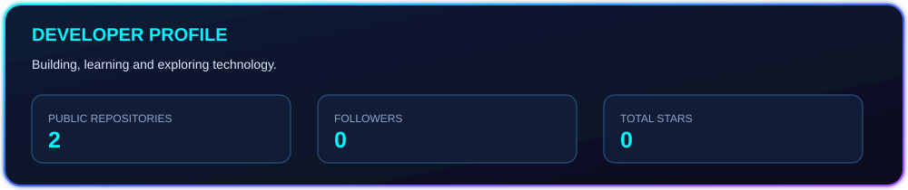

 

  

<table width="100%">
<tr>
<td align="center">

  

  

</td>
</tr>
</table>

---

<table width="100%">
<tr>
<td width="68%" valign="top">

### 👋 Hello, I'm Gagan Reddy

I'm interested in technology, software development and creating useful digital experiences.

- 🚀 Exploring new technologies and development tools.
- 💡 Solving problems through creative thinking.
- 🛠️ Building practical applications and experiments.
- 🧠 Improving my technical and problem-solving skills.
- 🤝 Open to learning and collaboration.

> "Great things are built one line of code at a time."

</td>
<td width="32%" align="center">

  

  

</td>
</tr>
</table>

---

  

  

  

<!-- REPO-LIST:START -->
| Repository | Description | Language | ⭐ Stars | Updated |
|:--|:--|:--:|--:|:--|
| [gagan77007](https://github.com/gagan77007/gagan77007) | A project from my GitHub profile. | Python | 0 | 2026-11-15 |
| [shopdirect-ordering-app](https://github.com/gagan77007/shopdirect-ordering-app) | Complete mobile-first single-shop ordering and store management web app built with React, HTML, TypeScript, Tailwind CSS, and Express. Includes customer storefront, live cart, atomic inventory, order tracking, and unified owner admin console. | TypeScript | 0 | 2026-11-07 |
<!-- REPO-LIST:END -->

---

  

Automatically updated from my public repositories.

  

<!-- LANGUAGES:START -->

<!-- LANGUAGES:END -->

---

  

  

---

  

### 🤝 Let's learn and build together

  

  

✦ Designed with code, creativity and curiosity ✦

