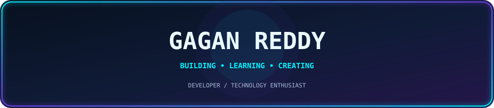
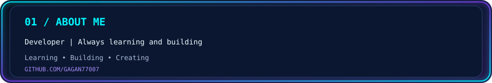
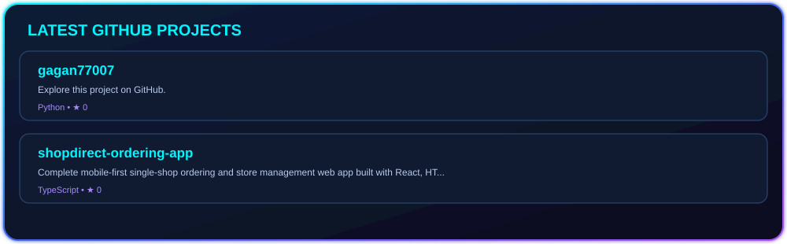

### MY CODING SPACE

### PROJECT REPOSITORIES

<!-- REPO-LIST:START -->
<!-- REPO-LIST:END -->

### LANGUAGE DISTRIBUTION

<!-- LANGUAGES:START -->
<!-- LANGUAGES:END -->

### GITHUB CONTRIBUTIONS

