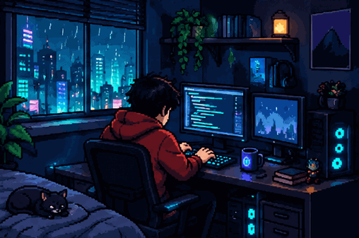

 

---

### ◈ 01 — DEVELOPER PROFILE

### ◈ 02 — MY CODING SPACE

### ◈ 03 — TECHNOLOGIES & TOOLS

### ◈ 04 — DEVELOPER TERMINAL

### ◈ 05 — FEATURED PROJECTS

### ◈ 06 — REPOSITORY COLLECTION

<!-- REPO-LIST:START -->
<!-- REPO-LIST:END -->

### ◈ 07 — LANGUAGE DISTRIBUTION

<!-- LANGUAGES:START -->
<!-- LANGUAGES:END -->

### ◈ 08 — CONTRIBUTION ACTIVITY

### ◈ 09 — GITHUB STATISTICS

### ◈ CONNECT WITH ME

  

**THANK YOU FOR VISITING MY PROFILE**

Designed with passion • Built with code

